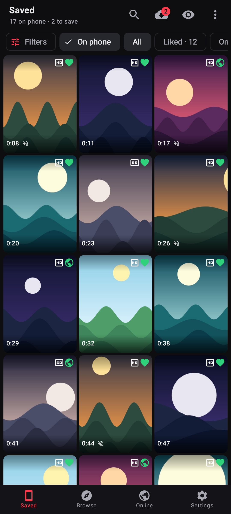
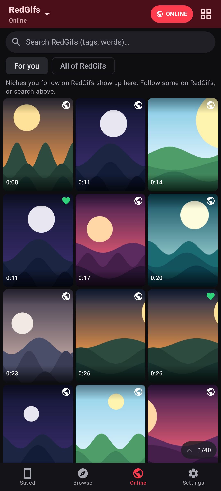
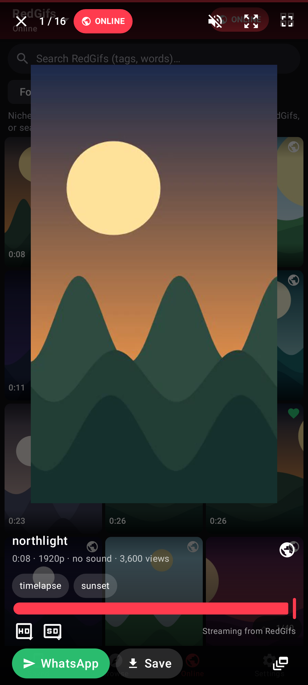
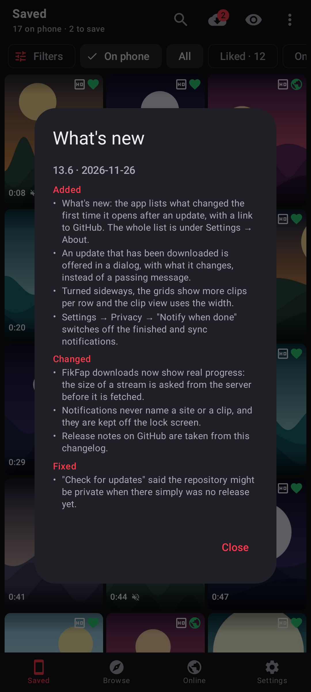
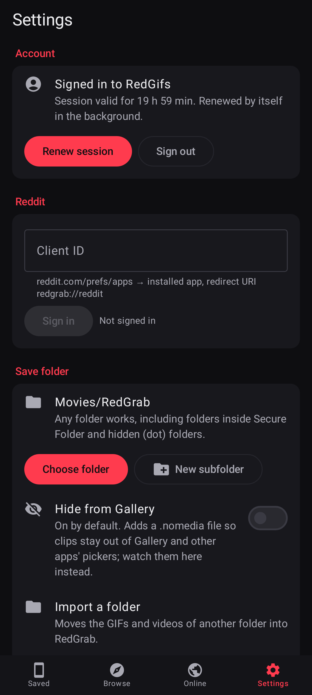
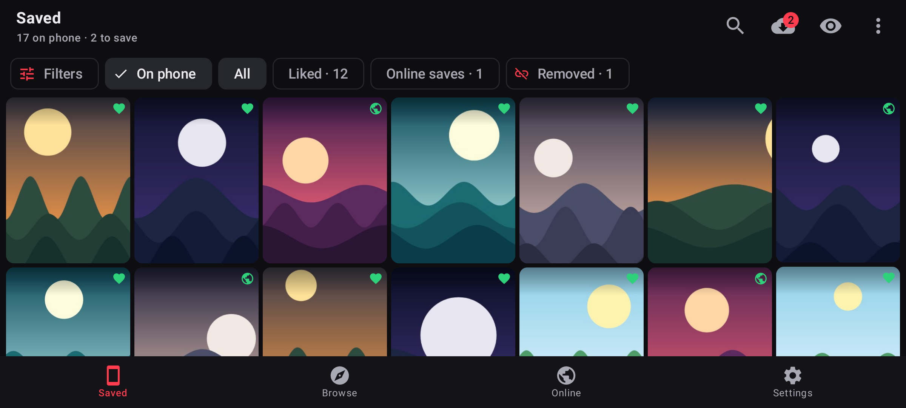

# RedGrab

Android app that saves your RedGifs likes and collections for offline viewing, and browses and saves clips from a few other sites.

Personal project. Adult content. Not affiliated with any of the sites.

## Screenshots

Taken on an emulator with made-up clips. The thumbnails are drawn by the screenshot test; nothing in them comes from any site.

<p>
  
  
  
</p>
<p>
  
  
</p>
<p>
  
</p>

## Features

**Library**
- Syncs your RedGifs likes and collections; downloads in HD, falls back to SD
- Resumes interrupted downloads; retries failures; skips clips the site has deleted and takes them out of your RedGifs collections
- Download queue: save all, clear all, or take single clips out
- Quick sync (only what is new), full sync weekly or on demand
- Background sync every 12 hours by default; downloads new clips of chosen collections; mobile data only if you allow it
- Filter by tag, creator, niche, your own categories, length, orientation, sound
- Import a folder of existing clips
- Finds byte-identical duplicates

**Online tab**

| Source | Browse by | Needs |
| --- | --- | --- |
| All sites | your feed across every site (what you follow on each), one search | whatever each site needs |
| RedGifs | My feed (followed niches and tags), For you, search with suggestions, exact tags, niche browser, creator, related | RedGifs sign-in |
| Reddit | front page, subreddit (with suggestions), user, your saved/upvoted | a client ID |
| FikFap | hashtag, user; followed hashtags | nothing |
| sex.com | GIF search; followed searches | nothing |
| EroMe | Hot, New, search, user; followed searches | nothing |
| 4chan | boards, threads, thread search; followed searches | nothing |

Search suggests only tags, niches, creators and subreddits that exist. RedGifs' tag and niche lists are cached on the phone.

A content filter (straight, lesbian, gay, trans, bisexual, animated) applies to every site and search. Gay and trans are off until switched on.

**Viewing**
- Grid or wall layout, 2–6 per row, more when the phone is sideways
- Previews play for what is on screen, from small copies made on the phone
- Clips open over the grid; tap beside the clip to go back
- Page indicator with back-to-top and go-to-page

**Other**
- Trim, mute and save edited copies
- Share to WhatsApp
- SFW mode (blurs previews, blocks playback)
- App lock using the phone's fingerprint, face, PIN, pattern or password; while on, the app can't be screenshotted or recorded
- Updates itself from this repository's releases (Android asks once to allow it)
- Changelog shown after each update

## Install

1. Download the latest `RedGrab-<version>-<build>.apk` from [Releases](https://github.com/tritnaha/redgrab/releases).
2. Open it and allow installing from that source.
3. Clips are kept inside the app. "Export all" in Settings writes plain copies to a folder you pick.
4. Sign in to RedGifs under Settings → Account. You sign in on the site's own page inside the app.

Requires Android 16 or later.

Later versions install over earlier ones as long as they come from Releases. Android refuses a build signed with a different key.

The app looks for new releases by itself (when opened, and every six hours in the background).

### Reddit

Reddit needs a client ID, unless the build carries one (`-PredditClientId=…`, or the repository variable `REDDIT_CLIENT_ID` for releases):

1. Go to <https://www.reddit.com/prefs/apps> and create an app of type **installed app**.
2. Set the redirect URI to `redgrab://reddit`.
3. Paste the client ID into Settings → Reddit and sign in.

## Privacy and security

- Sign-in tokens are encrypted with AES-256-GCM under a key held in the Android Keystore.
- Nothing is backed up to the cloud or copied to a new device.
- No analytics, no ads, no servers of its own. The app talks only to the sites you browse and to GitHub for updates.
- Notifications never name a site or a clip and stay off the lock screen.
- The activity log stays inside the app; copies and reports have sign-ins removed.
- Clips can be kept inside the app's own storage, which no gallery, file browser or USB connection can list (the default for new installs; Settings → Save folder → "Keep inside the app" moves an existing folder in). "Export all" writes plain copies out; "Use a visible folder" moves everything back out. Android offers to keep the app's data on uninstall, and its "Clear storage" opens a warning first.
- With a save folder instead, clips are ordinary files there, and the app lock covers the app, not that folder.
- The built-in browser's cookies are stored like any browser's and are removed when you sign out.

## Build

Needs JDK 17 or later and the Android SDK (platform 37).

```bash
./gradlew testDebugUnitTest assembleDebug
```

```bash
./gradlew assembleRelease
```

- The APK lands in `app/build/outputs/apk/`.
- A release build is signed with `signing/release.keystore` if that file exists, otherwise with the local debug key. The key is not in the repository.
- `-PsideBySide` builds a separate "RedGrab test" app that installs next to the normal one.
- Release builds leave out unused code and resources (about 6.5 MB instead of 18 MB); names are not obfuscated. `-PnoShrink` builds it whole.

### Tests

```bash
./gradlew testDebugUnitTest
```

One test runs against the real RedGifs site and is skipped unless asked for:

```bash
REDGRAB_LIVE=1 ./gradlew testDebugUnitTest --tests '*LiveRedGifsTest*'
```

Another asks GitHub for the latest release as the app's updater does, without a token:

```bash
REDGRAB_LIVE=1 ./gradlew testDebugUnitTest --tests '*LiveUpdateTest*'
```

### Screenshots

`app/src/androidTest/.../ScreenshotsTest.kt` fills the app with sample clips and takes the pictures above. It needs an emulator or a spare phone (it overwrites the app's sign-in and library there):

```bash
./gradlew assembleDebug assembleDebugAndroidTest
```

```bash
adb install -r app/build/outputs/apk/debug/app-debug.apk
```

```bash
adb install -r app/build/outputs/apk/androidTest/debug/app-debug-androidTest.apk
```

```bash
adb shell am instrument -w -e class app.redgrab.ScreenshotsTest app.redgrab.test/androidx.test.runner.AndroidJUnitRunner
```

```bash
adb pull /sdcard/Android/data/app.redgrab/files/shots screenshots
```

### Releases

Pushing a new `versionName` in `app/build.gradle.kts` runs `.github/workflows/release.yml`, which builds, signs and publishes `v<version>`. The jobs are split so the signing key (build) and the right to publish (publish) never share a job with third-party actions (the emulator tests).

- Needs the repository secret `SIGNING_KEYSTORE_B64` (the keystore, base64-encoded), and `SIGNING_STORE_PASSWORD` and `SIGNING_KEY_PASSWORD` unless the key uses the Android tools' standard password. Optional: `SIGNING_KEY_ALIAS`.
- Workflow actions are pinned to commits. A brief for an outside security review is in [`docs/SECURITY_AUDIT_BRIEF.md`](docs/SECURITY_AUDIT_BRIEF.md).
- The emulator runs Android 16; older versions are not tested.
- Release notes come from the version's section in [`CHANGELOG.md`](CHANGELOG.md). The build fails if the current version has no entry.
- Before publishing, the last release is installed on an emulator and updated to the new build; the app has to start. The on-device tests run beside it.
- After publishing, the release before is installed on an emulator and has to update itself through the app's own updater. "Run workflow" with `updater` ticked runs only that.
- The on-device tests' screenshots are pushed to the branch `ci-screenshots`; the pictures above are copied from there.

## Project layout

| Path | What |
| --- | --- |
| `app/src/main/java/app/redgrab/` | App code |
| `.../ui/` | Compose screens |
| `.../RedGifsApi.kt`, `Sources.kt`, `MoreSources.kt` | Site clients |
| `.../DownloadWorker.kt`, `SyncWorker.kt` | Background downloads and sync |
| `.../Library.kt`, `Lib*.kt`, `Clip.kt`, `Db.kt` | Library state (by topic) and database |
| `.../MainViewModel.kt`, `Vm*.kt`, `Feed.kt` | Screen state, and its functions by topic |
| `.../Updater.kt`, `Changelog.kt` | Updates and changelog |
| `.../SearchIndex.kt` | Cached tag and niche lists, suggestion matching |
| `.../SecretStore.kt`, `AppLock.kt` | Token storage and app lock |
| `.../PrivateDocs.kt` | Clips kept inside the app |
| `app/src/test/` | Unit tests |

Built with Kotlin, Jetpack Compose, Media3, Room, WorkManager, OkHttp and Coil.

## Known limits

- 4chan, EroMe, sex.com and FikFap are checked against the real sites by the "Live sites" workflow (feeds, paging, files). Reddit is checked there too once a client ID is set; until then its code has not been run against the site.
- Following on sites other than RedGifs and Reddit is kept in the app, not on the site.
- Reddit-hosted videos are saved without sound.
- 4chan clips are mostly WebM, which some apps won't play or accept.
- FikFap streams can't be resumed part-way.
- Sites change. When one does, its source breaks until the client is updated.

## Changelog

See [`CHANGELOG.md`](CHANGELOG.md).
