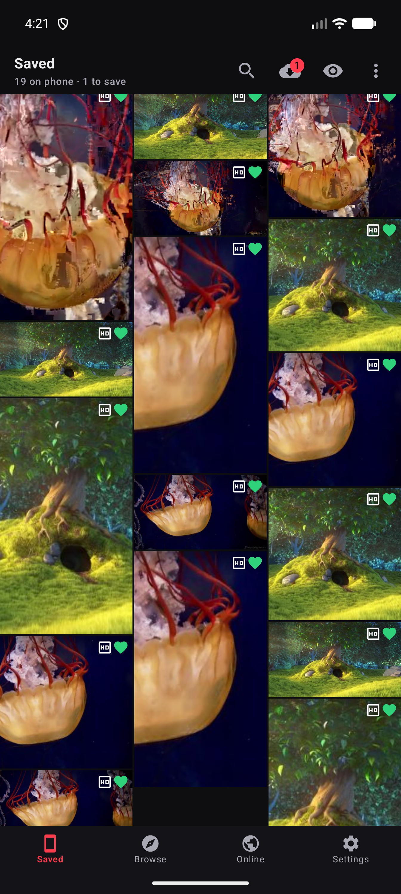
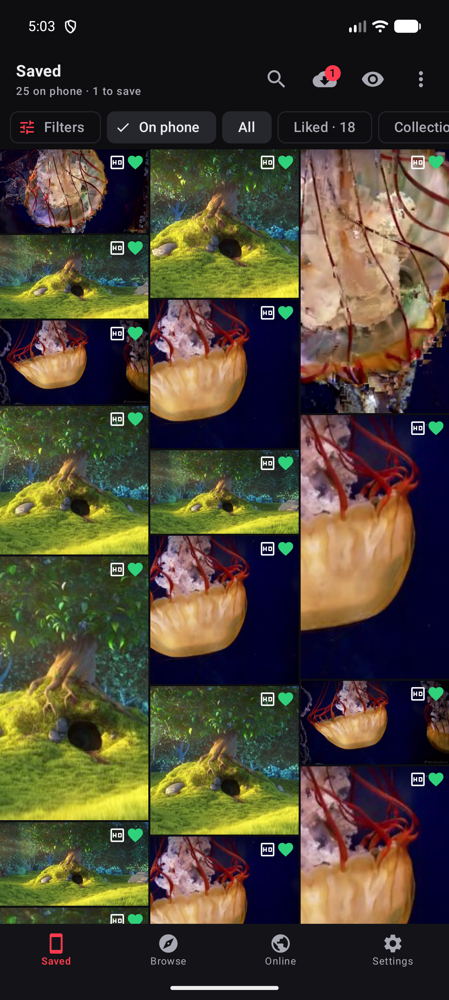
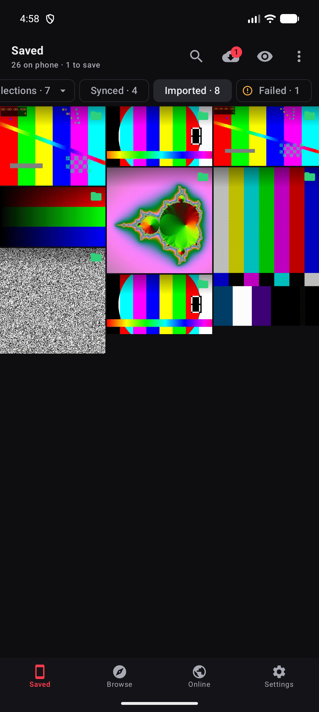

# RedGrab

Android app that saves your RedGifs likes and collections for offline viewing, and browses and saves clips from a few other sites.

Personal project. Adult content. Not affiliated with any of the sites.

## Screenshots

From version 12, with test footage.

<p>
  
  
  
</p>

## Features

**Library**
- Syncs your RedGifs likes and collections; downloads in HD, falls back to SD
- Resumes interrupted downloads; retries failures; skips clips the site has deleted
- Background sync for chosen collections (optionally Wi-Fi only)
- Filter by tag, creator, niche, your own categories, length, orientation, sound
- Import a folder of existing clips
- Finds byte-identical duplicates

**Online tab**

| Source | Browse by | Needs |
| --- | --- | --- |
| RedGifs | For you, search, niche, creator, related | RedGifs sign-in |
| Reddit | front page, subreddit, user, your saved/upvoted | your own client ID |
| FikFap | hashtag, user | nothing |
| sex.com | GIF search | nothing |
| EroMe | search, user | nothing |
| 4chan | `/gif/` threads | nothing |

**Viewing**
- Grid or wall layout, 2–6 per row, more when the phone is sideways
- Previews play for what is on screen, from small copies made on the phone
- Clips open over the grid; tap beside the clip to go back
- Page indicator with back-to-top and go-to-page

**Other**
- Trim, mute and save edited copies
- Share to WhatsApp
- SFW mode (blurs previews, blocks playback)
- App lock using the phone's fingerprint, face, PIN, pattern or password
- Updates itself from this repository's releases
- Changelog shown after each update

## Install

1. Download the latest `RedGrab-<version>-<build>.apk` from [Releases](https://github.com/tritnaha/redgrab/releases).
2. Open it and allow installing from that source.
3. Choose a save folder in Settings.
4. Sign in to RedGifs under Settings → Account. You sign in on the site's own page inside the app.

Requires Android 8.0 or later.

Later versions install over earlier ones as long as they come from Releases. Android refuses a build signed with a different key.

### Reddit

Reddit needs a client ID of your own:

1. Go to <https://www.reddit.com/prefs/apps> and create an app of type **installed app**.
2. Set the redirect URI to `redgrab://reddit`.
3. Paste the client ID into Settings → Reddit and sign in.

## Privacy and security

- Sign-in tokens are encrypted with AES-256-GCM under a key held in the Android Keystore.
- Nothing is backed up to the cloud or copied to a new device.
- No analytics, no ads, no servers of its own. The app talks only to the sites you browse and to GitHub for updates.
- Notifications never name a site or a clip and stay off the lock screen.
- Saved clips are ordinary files in the folder you choose. The app lock covers the app, not that folder.
- The built-in browser's cookies are stored like any browser's and are removed when you sign out.

## Build

Needs JDK 17 or later and the Android SDK (platform 37).

```bash
./gradlew testDebugUnitTest assembleDebug
```

```bash
./gradlew assembleRelease
```

- The APK lands in `app/build/outputs/apk/`.
- A release build is signed with `signing/release.keystore` if that file exists, otherwise with the local debug key. The key is not in the repository.
- `-PsideBySide` builds a separate "RedGrab test" app that installs next to the normal one.

### Tests

```bash
./gradlew testDebugUnitTest
```

One test runs against the real RedGifs site and is skipped unless asked for:

```bash
REDGRAB_LIVE=1 ./gradlew testDebugUnitTest --tests '*LiveRedGifsTest*'
```

### Releases

Pushing a new `versionName` in `app/build.gradle.kts` runs `.github/workflows/release.yml`, which builds, signs and publishes `v<version>`.

- Needs the repository secret `SIGNING_KEYSTORE_B64` (the keystore, base64-encoded).
- Release notes come from the version's section in [`CHANGELOG.md`](CHANGELOG.md). The build fails if the current version has no entry.

## Project layout

| Path | What |
| --- | --- |
| `app/src/main/java/app/redgrab/` | App code |
| `.../ui/` | Compose screens |
| `.../RedGifsApi.kt`, `Sources.kt`, `MoreSources.kt` | Site clients |
| `.../DownloadWorker.kt`, `SyncWorker.kt` | Background downloads and sync |
| `.../Library.kt`, `Db.kt` | Library state and database |
| `.../Updater.kt`, `Changelog.kt` | Updates and changelog |
| `.../SecretStore.kt`, `AppLock.kt` | Token storage and app lock |
| `app/src/test/` | Unit tests |

Built with Kotlin, Jetpack Compose, Media3, Room, WorkManager, OkHttp and Coil.

## Known limits

- Clients for Reddit, FikFap, sex.com, EroMe and 4chan are written from open-source extractor code and have not been tested against the live sites from the build environment.
- Reddit-hosted videos are saved without sound.
- 4chan clips are mostly WebM, which some apps won't play or accept.
- FikFap streams can't be resumed part-way.
- Sites change. When one does, its source breaks until the client is updated.

## Changelog

See [`CHANGELOG.md`](CHANGELOG.md).
